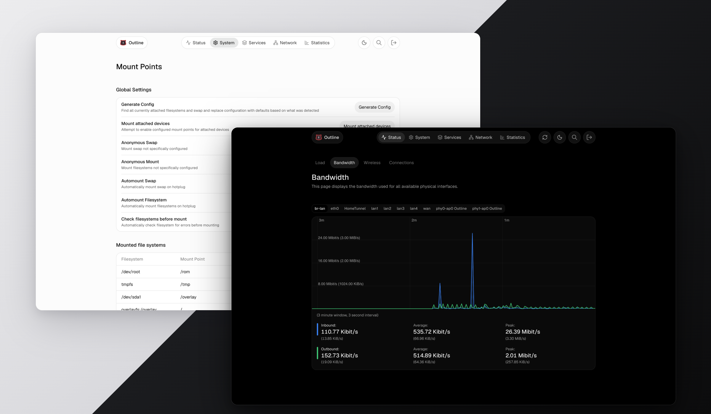
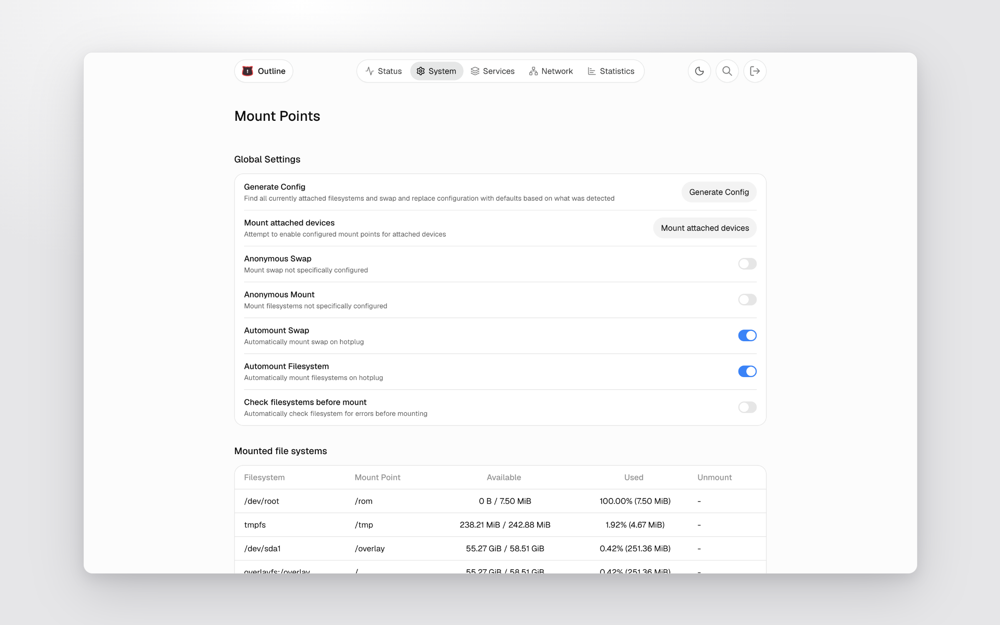
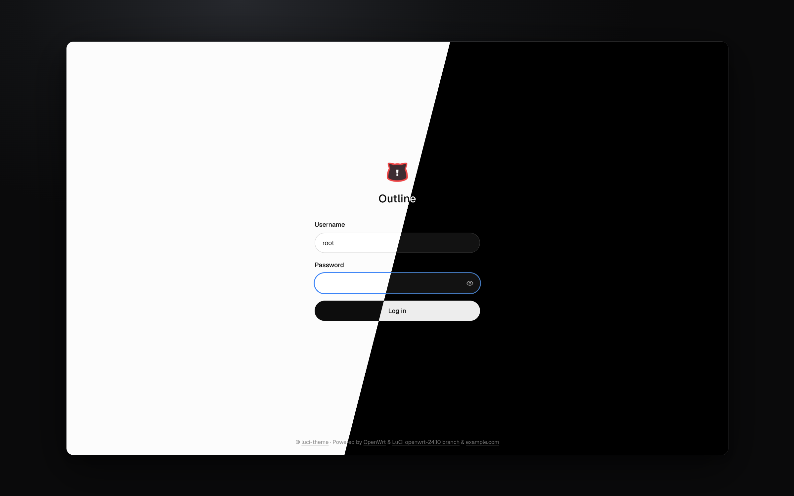
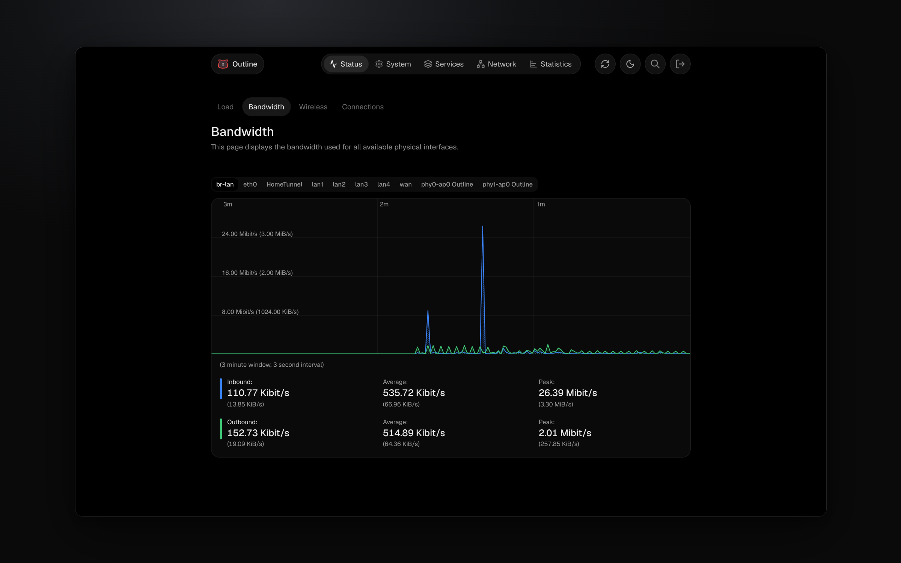
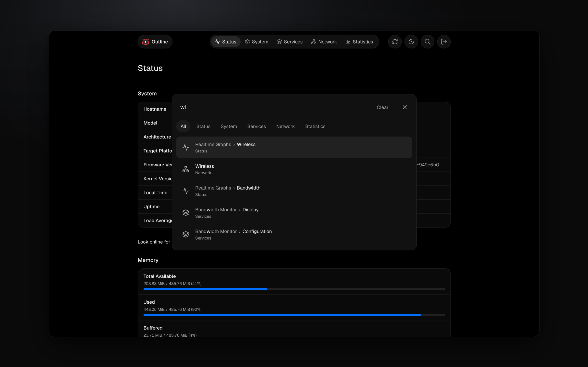
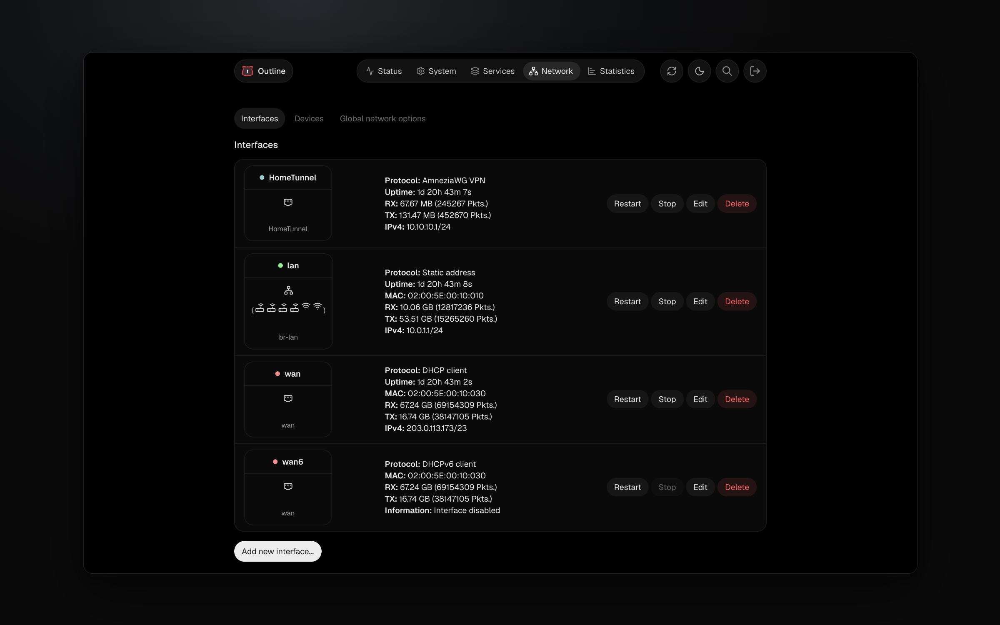
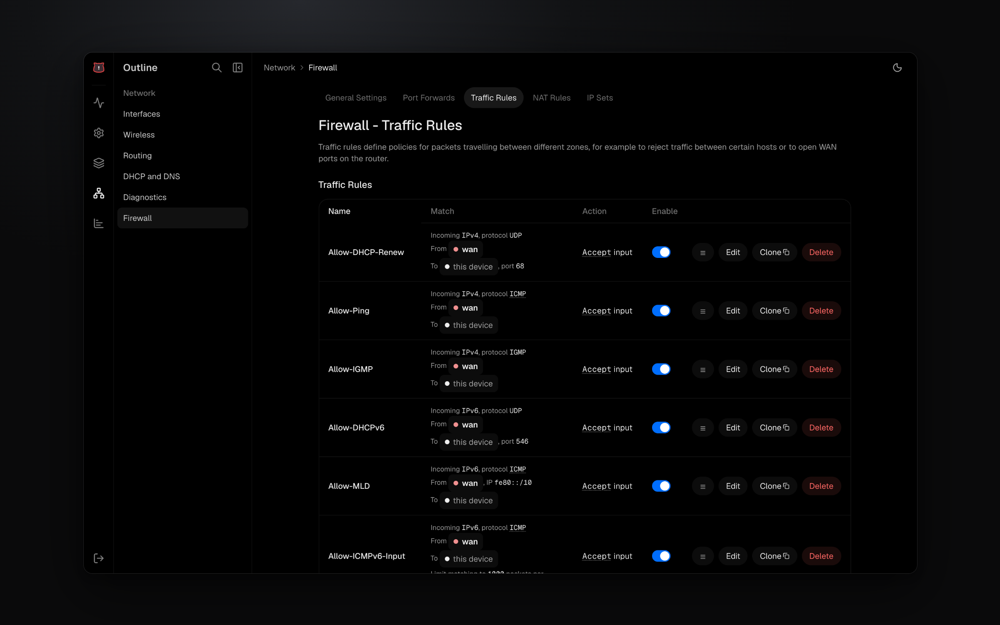
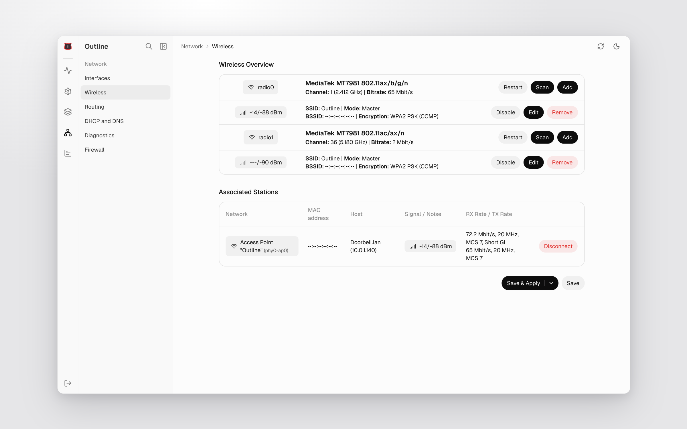
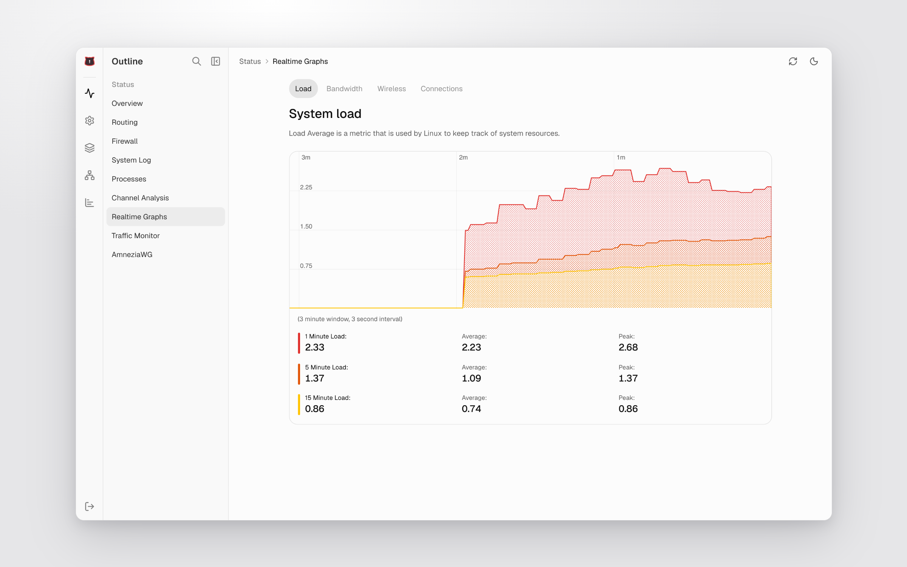
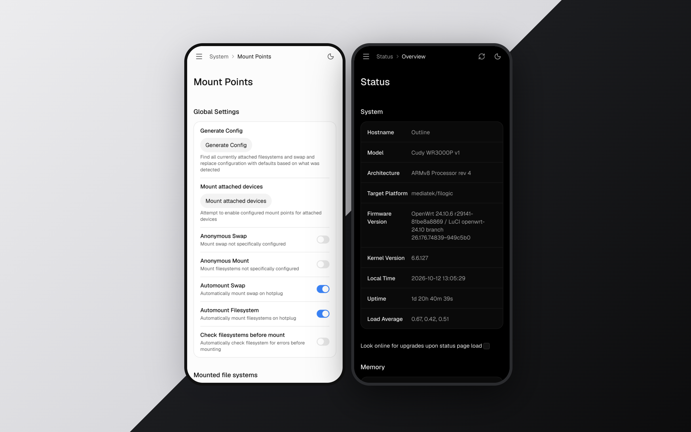

<h4 align="right"><a href="README.md">English</a> | <strong>简体中文</strong></h4>
<p align="center">
    
</p>
<p align="center"><strong>Outline — 一款 ChatGPT 风格的 OpenWrt LuCI 主题。</strong></p>
<div align="center">
  <a href="https://openwrt.org"></a>
  <a href="https://github.com/tickcount/luci-theme/releases/latest"></a>
  <a href="https://github.com/tickcount/luci-theme/releases"></a>
</div>

<p align="center">
  
</p>

## 特性

- **侧边栏布局**：ChatGPT 风格的图标栏加单分区面板，可折叠，支持移动端抽屉。
- **快且丝滑的导航体验**：在支持的浏览器上，切换页面时只更新内容、不整页刷新，切换起来丝滑流畅，加载速度大幅提升（详见[路由文档](.dev/docs/router.md)）。这套无刷新切换的思路参考了 [luci-theme-footstrap](https://github.com/VizzleTF/luci-theme-footstrap)。
- **深色/浅色模式**：内置切换按钮，偏好自动保存，加载时无闪烁恢复。
- **命令面板（⌘K）**：ChatGPT 风格的搜索对话框——从侧边栏跳转到任意页面或标签页。
- **ChatGPT 风格设计**：参照 ChatGPT 设置页——胶囊控件、细线卡片、次级色说明文字、Analytics 风格的图表与图例。
- **现代技术栈**：界面加载迅速、切换流畅，字体与图标经过精心挑选。

## 预览

<table>
  <tr>
    <td></td>
    <td></td>
  </tr>
  <tr>
    <td></td>
    <td></td>
  </tr>
  <tr>
    <td></td>
    <td></td>
  </tr>
  <tr>
    <td></td>
    <td></td>
  </tr>
</table>

<p align="center">
  
</p>

## 兼容性

- **OpenWrt**：需要 OpenWrt 23.05.0 或更高版本（依赖 ucode 模板和 LuCI JavaScript APIs）。
- **浏览器**：基于 **TailwindCSS v4** 构建。兼容以下现代浏览器：
  - **Chrome/Edge 111+** _(2023 年 3 月发布)_
  - **Safari 16.4+** _(2023 年 3 月发布)_
  - **Firefox 128+** _(2024 年 7 月发布)_
  - _可选增强，非必需：_ 页面间的同文档导航（点菜单不整页刷新）在支持的浏览器上使用 [Navigation API](https://developer.mozilla.org/en-US/docs/Web/API/Navigation_API)——Chrome/Edge 105+、Safari 26.2+、Firefox 147+；不支持的浏览器自动保持传统整页跳转，功能不受影响。

## 安装

以下命令均在路由器本机执行（例如通过 SSH 会话）。

### 通过 GitHub Release

OpenWrt 25.12+ 及 Snapshot 版本使用 `apk`；旧版本使用 `opkg`。

> **提示**：运行 `opkg --version` 或 `apk --version`，有输出的那个就是您设备的包管理器。

```sh
cd /tmp

# opkg
uclient-fetch -O luci-theme-outline.ipk https://github.com/tickcount/luci-theme/releases/latest/download/luci-theme-outline_1.0.2-r20261012_all.ipk
opkg install luci-theme-outline.ipk

# apk
uclient-fetch -O luci-theme-outline.apk https://github.com/tickcount/luci-theme/releases/latest/download/luci-theme-outline-1.0.2-r20261012.apk
apk add --allow-untrusted luci-theme-outline.apk
```

## 从源码构建

使用 OpenWrt 构建系统自行编译。主机前置条件见 [Build system setup](https://openwrt.org/docs/guide-developer/toolchain/install-buildsystem)。产物位于 `bin/packages/<arch>/base/`（例如 `bin/packages/x86_64/base/luci-theme-outline_*_all.ipk`），拷贝到路由器后按上文方式安装即可。

### 通过完整源码或 SDK

准备环境——克隆完整源码：

```sh
# 完整源码——openwrt-24.10 分支构建 .ipk，main 分支构建 .apk
git clone https://github.com/openwrt/openwrt.git
cd openwrt
git checkout openwrt-24.10
```

或 [预编译 SDK](https://openwrt.org/docs/guide-developer/toolchain/using_the_sdk)（更快，省去编译工具链）。从 [downloads.openwrt.org](https://downloads.openwrt.org) 下载与目标匹配的压缩包，下载页面按 Release 和 Snapshot 分类——Release 24.10.x 及以下构建 `.ipk`；Release 25.12+ 和 Snapshot 构建 `.apk`（文件名、架构、压缩格式因目标而异）：

```sh
wget <从 downloads.openwrt.org 获取的 SDK 压缩包地址>
tar -xf openwrt-sdk-*.tar.*
cd openwrt-sdk-*/
```

然后在该目录下：

```sh
# 加入本软件包并安装 feeds（提供 luci-base）
git clone https://github.com/tickcount/luci-theme.git package/luci-theme-outline
./scripts/feeds update -a
./scripts/feeds install -a

# 在 menuconfig 中勾选主题：LuCI → Themes → luci-theme-outline
make menuconfig

# 用 SDK 时跳过这两行——它已自带编译好的工具链
make tools/install -j$(nproc)
make toolchain/install -j$(nproc)

make package/luci-theme-outline/compile -j$(nproc) V=s
```

## 许可与致谢

[Apache 2.0](LICENSE)。致谢：

- [luci-theme-shadcn](https://github.com/eamonxg/luci-theme-shadcn) — Outline 由此主题分叉而来
- [shadcn/ui](https://github.com/shadcn-ui/ui) — 最初的设计语言
- [Lucide](https://github.com/lucide-icons/lucide) — 图标库
- [Linear](https://linear.app) — 色彩系统灵感
- [Vite](https://vite.dev/) 和 [Tailwind CSS](https://tailwindcss.com/)
- [luci-theme-bootstrap](https://github.com/openwrt/luci/tree/master/themes/luci-theme-bootstrap) — 模板结构与 LuCI 集成参考
- [luci-theme-material](https://github.com/openwrt/luci/tree/master/themes/luci-theme-material) — 侧边栏菜单渲染参考
- [luci-theme-footstrap](https://github.com/VizzleTF/luci-theme-footstrap) — 一个自带客户端路由的 LuCI 主题。同文档导航借鉴了它的部分思路，并改用 Navigation API 实现——详见[路由文档](.dev/docs/router.md)
- [Claude Code](https://claude.ai/code)
